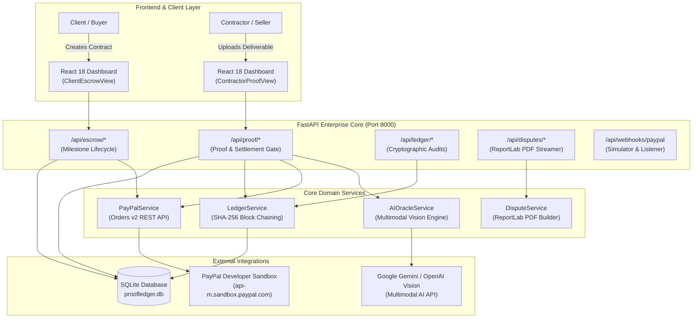

# 🔬 Technical Architecture & API Deep-Dive

> **Technical reference for judges, architectural review, and technical form fields.**

---

## 1. System Architecture Diagram



---

## 2. PayPal Orders v2 Financial Flow

ProofLedger harnesses PayPal's two-step authorization hold lifecycle:

1. **Order Creation (`POST /v2/checkout/orders`):**
   - Payload:
     ```json
     {
       "intent": "AUTHORIZE",
       "purchase_units": [
         {
           "reference_id": "ms-hvac-7701",
           "description": "HVAC Capacitor Replacement & Pressure Gauge Calibration",
           "amount": { "currency_code": "USD", "value": "250.00" }
         }
       ],
       "application_context": {
         "brand_name": "ProofLedger AI Escrow",
         "user_action": "CONTINUE",
         "return_url": "http://localhost:8000/escrow/approved?milestone=ms-hvac-7701",
         "cancel_url": "http://localhost:8000/escrow/cancelled"
       }
     }
     ```
   - PayPal reserves buyer funds and returns the `approve` HATEOAS link.

2. **Authorization Hold (`POST /v2/checkout/orders/{id}/authorize`):**
   - Places an active 29-day authorization hold on the buyer's account.
   - Milestone status updates from `DRAFT` $\rightarrow$ `ESCROW_LOCKED`.

3. **Autonomous Settlement Gate:**
   - **PASS ($\ge$ 60% confidence):** Calls `POST /v2/payments/authorizations/{authorization_id}/capture`. Funds are captured and transferred to the seller immediately.
   - **FAIL (< 60% confidence):** Calls `POST /v2/payments/authorizations/{authorization_id}/void`. Authorization hold is immediately canceled, returning the reserved funds to the buyer.

---

## 3. Multimodal AI Vision Oracle Architecture

The AI Oracle operates in three distinct layers:

1. **Forensic Image Pre-processing:**
   - Evaluates image dimensions, channels, brightness mean, and standard deviation luminance.
   - Standardizes non-RGB formats (RGBA, P, L) to 3-channel RGB.
   - Verifies minimum clarity standards (`stddev >= 10.0`, `15.0 <= mean_brightness <= 245.0`).

2. **Multimodal Criteria Scoring:**
   - Breaks contractual specifications down into independent criteria.
   - Inspects image features (e.g., dial pressure readings, capacitor wiring terminals, cut copper).
   - Generates structured JSON adhering to `AIVerdict` schema.

3. **System Prompt for Financial Decision-Making:**
   ```text
   You are the ProofLedger Autonomous Verification Oracle.
   Your duty is to objectively inspect submitted photographic/documentary evidence against contractual criteria.
   Be rigorous, objective, and conservative. Verify each criterion independently.
   Evaluate whether each item is clearly evidenced in the image without speculation.
   ```

---

## 4. Cryptographic Proof Ledger Math

The audit trail is structured as an immutable hash-chained block ledger:

$$\text{Block Hash}_n = \text{SHA-256}\Big(\text{Hash}_{n-1} \parallel \text{Timestamp} \parallel \text{Event Type} \parallel \text{Milestone ID} \parallel \text{Payload JSON}\Big)$$

- **Genesis Block:** Hardcoded block at height 0 with `prev_hash: "0"*64`.
- **Tamper Verification Algorithm:** Recomputes the SHA-256 hash sequentially across all $N$ blocks. If any block's payload or previous link has been altered, the verification immediately fails and pinpoints the corrupted block ID.

---

## 5. Automated Test Suite (Pytest 21/21 Passing)

```text
backend/tests/test_ai_oracle.py::test_ai_oracle_pass_evaluation PASSED            [  4%]
backend/tests/test_ai_oracle.py::test_ai_oracle_fail_evaluation PASSED            [  9%]
backend/tests/test_ai_oracle.py::test_ai_oracle_corrupt_file_evaluation PASSED    [ 14%]
backend/tests/test_ai_oracle.py::test_ai_oracle_clarity_failure_evaluation PASSED [ 19%]
backend/tests/test_ai_oracle.py::test_ai_oracle_needs_review_evaluation PASSED    [ 23%]
backend/tests/test_escrow_api.py::test_api_health PASSED                          [ 28%]
backend/tests/test_escrow_api.py::test_list_milestones PASSED                     [ 33%]
backend/tests/test_escrow_api.py::test_create_and_authorize_milestone PASSED      [ 38%]
backend/tests/test_escrow_api.py::test_ledger_integrity_endpoint PASSED           [ 42%]
backend/tests/test_escrow_api.py::test_dispute_pack_export_json_and_pdf PASSED    [ 47%]
backend/tests/test_escrow_api.py::test_proof_submission_and_autonomous_capture PASSED [ 52%]
backend/tests/test_escrow_api.py::test_state_machine_transition_guards PASSED     [ 57%]
backend/tests/test_escrow_api.py::test_proof_submission_validation_empty_and_bad_extension PASSED [ 61%]
backend/tests/test_escrow_api.py::test_webhook_order_approved_persists_authorization_id PASSED [ 66%]
backend/tests/test_ledger_service.py::test_genesis_block_exists PASSED            [ 71%]
backend/tests/test_ledger_service.py::test_append_block_and_verify PASSED          [ 76%]
backend/tests/test_ledger_service.py::test_tamper_detection PASSED                [ 80%]
backend/tests/test_paypal_service.py::test_paypal_create_escrow_order PASSED      [ 85%]
backend/tests/test_paypal_service.py::test_paypal_authorize_order PASSED          [ 90%]
backend/tests/test_paypal_service.py::test_paypal_capture_authorization PASSED    [ 95%]
backend/tests/test_paypal_service.py::test_paypal_void_authorization PASSED       [100%]
============================== 21 passed in 44.96s ==============================
```
