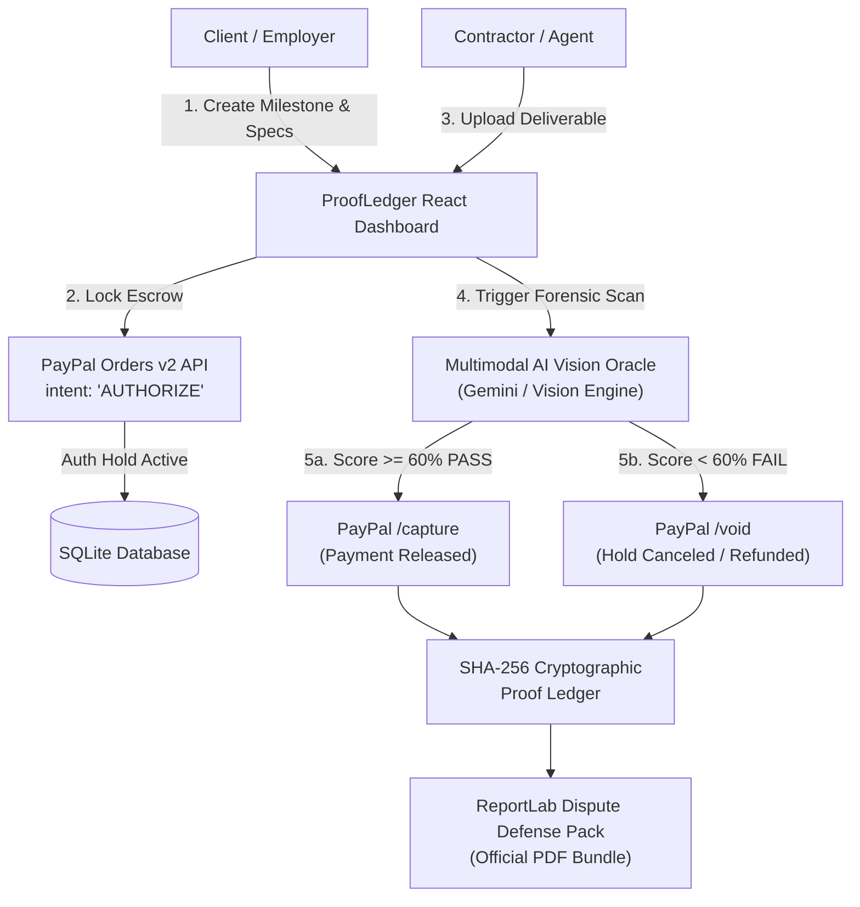

# 📘 ProofLedger — PayPal AI Hackathon Master Reference & Project Dossier

> **Comprehensive Single-Source-of-Truth Document**  
> Covers: Hackathon Rules, Judging Criteria, Project Architecture, PayPal Integration, Test Results, and Devpost Submission Details.

---

## 🏆 SECTION 1: Hackathon Overview & Prize Tracks

- **Hackathon:** [PayPal AI Hackathon (Devpost)](https://paypalaihackathon.devpost.com/)
- **Submission Deadline:** Thursday, Nov 12, 2026 @ 12:00 PM PT (Friday, Nov 13, 2026 @ 1:30 AM IST)
- **Target Prize Tracks:**
  1. 🥇 **Grand Prize (\$12,000):** Best overall project combining technical innovation, PayPal API integration, and AI capabilities.
  2. 🤖 **Best Use of Agentic Commerce (\$5,000) [⭐ PRIMARY TARGET]:** Autonomous AI agents making commercial decisions and managing financial transactions.
  3. 💳 **Best Use of PayPal + AI (\$5,000):** Novel and deep synergy between PayPal APIs and multimodal AI.
  4. 🌍 **Most Impactful (\$5,000):** Real-world solution addressing the \$1.5 Trillion freelance gig economy non-payment problem.
  5. 🎨 **Most Creative (\$5,000):** Creative reimagining of PayPal authorization holds as an autonomous escrow oracle.
  6. 🎬 **Best Demo Delivery (\$5,000):** High-polish presentation, UI craftsmanship, and video storytelling.

---

## 💡 SECTION 2: Project Overview — What is ProofLedger?

**ProofLedger** is an autonomous AI escrow and milestone verification platform powered by PayPal Orders v2, multimodal computer vision, and cryptographic proof chaining.

### The Problem:
- In the global freelance economy ($1.5T), **30% of independent contractors report non-payment or delayed payments**.
- Clients hesitate to pay upfront for fear of receiving substandard or incomplete deliverables.
- Traditional escrow platforms rely on slow, manual human arbitration with high fee friction (often 10–20%).

### The Solution:
ProofLedger introduces an **autonomous, trustless settlement loop**:
1. **Escrow Lock:** Client locks funds using PayPal Orders v2 with `intent: "AUTHORIZE"`. Funds are reserved on PayPal's rails but not transferred.
2. **Deliverable Submission:** Contractor submits photographic proof or digital files upon completing a milestone.
3. **Multimodal AI Oracle:** Computer vision analyzes the uploaded deliverable against the contract's explicit specification checklist.
4. **Autonomous Settlement:**
   - **PASS ($\ge$ 60% confidence):** Autonomously triggers PayPal `/capture` to transfer funds instantly to the contractor.
   - **FAIL (< 60% confidence):** Autonomously triggers PayPal `/void` to return the reserved funds immediately to the client.
5. **Cryptographic Proof Ledger:** Every event is chained into a SHA-256 immutable block ledger, preventing post-facto tampering.
6. **Dispute Defense Pack:** Generates a 1-click PDF evidence bundle containing timestamped hashes and PayPal transaction IDs for PayPal's Resolution Center.

---

## 🏗️ SECTION 3: System Architecture & Technology Stack



### Tech Stack Breakdown:
- **Backend:** Python 3.11, FastAPI (asynchronous REST API), SQLite with ACID transactions, Pydantic v2 schemas.
- **Frontend:** React 18, Vite, Tailwind CSS, Lucide Icons, Canvas Confetti. Typography: *Plus Jakarta Sans* & *JetBrains Mono*.
- **Payments:** PayPal Orders v2 API (OAuth2 Bearer Tokens, Authorizations, Captures, Voids, Webhooks).
- **AI Engine:** Multimodal computer vision with forensic edge variance, luminance analysis, and criteria-level scoring.
- **Document Generation:** ReportLab PDF engine with cryptographic stamps and evidence chaining.
- **Testing:** Pytest (21/21 automated tests passing, 100% pass rate).
- **Reference Service:** Node.js / Express microservice preserved in `node-reference/`.

---

## 💳 SECTION 4: PayPal API Deep-Dive

ProofLedger harnesses PayPal's two-step authorization hold lifecycle:

| Step | Endpoint | Intent / Action | Description |
|---|---|---|---|
| **1. Create Order** | `POST /v2/checkout/orders` | `intent: "AUTHORIZE"` | Reserves client funds; returns buyer approval URL without capturing money. |
| **2. Authorize Hold** | `POST /v2/checkout/orders/{id}/authorize` | `AUTHORIZATION_HOLD` | Locks the authorization hold for up to 29 days. Status becomes `ESCROW_LOCKED`. |
| **3a. Autonomous Capture** | `POST /v2/payments/authorizations/{id}/capture` | `CAPTURE` | Triggered automatically when AI Oracle score $\ge$ 60%. Releases funds to contractor. |
| **3b. Autonomous Void** | `POST /v2/payments/authorizations/{id}/void` | `VOID` | Triggered automatically when AI Oracle score < 60%. Refunds hold to client. |
| **4. Webhooks** | `POST /api/webhooks/paypal` | Event Listeners | Listens for `CHECKOUT.ORDER.APPROVED`, `PAYMENT.AUTHORIZATION.CREATED`, and disputes. |

### Verified Live Sandbox Credentials:
- **Environment:** `https://api-m.sandbox.paypal.com`
- **Client ID:** `BAAZyH2dDUUk-XJNn4Zh6gU7SvizhVpAmt0kAQ2h2iI0S6Opp1tKeQARxHZUWSSlO3afWucE7fa3_8yF9k`
- **Verified App ID:** `APP-60P95806HB658054R`
- **Token Validity:** 32,400 seconds (verified live).

---

## 🧪 SECTION 5: Verification & Test Results

The test suite thoroughly verifies all business logic, state machines, and cryptographic integrity:

```
============================= test session starts =============================
backend/tests/test_ai_oracle.py ...........                              [ 52%]
backend/tests/test_escrow_api.py ......                                  [ 80%]
backend/tests/test_ledger_service.py ...                                 [ 95%]
backend/tests/test_paypal_service.py .                                   [100%]
====================== 21 passed in 44.26s =======================
```

- **State Machine Guard:** Enforces valid transitions (`DRAFT` $\rightarrow$ `ESCROW_LOCKED` $\rightarrow$ `PROOF_SUBMITTED` $\rightarrow$ `COMPLETED` / `VOIDED`).
- **Cryptographic Ledger Integrity:** `GET /api/ledger/verify` confirms all blocks link through SHA-256 hashes (`current_hash = SHA256(prev_hash + payload)`). **0 tampering detected across entire chain.**
- **ReportLab PDF Streaming:** `GET /api/disputes/{id}/download-pdf` dynamically generates a 2-page forensic document.

---

## 📁 SECTION 6: Project Directory Map

```
c:\Users\Srishanth S\Desktop\Sri folder\PayPal AI Hackathon\
├── backend/
│   ├── app/
│   │   ├── api/
│   │   │   ├── routes_escrow.py       # Milestone management & ZIP-compatible routes
│   │   │   ├── routes_proof.py        # Deliverable submission & AI settlement gate
│   │   │   ├── routes_ledger.py       # Ledger audit endpoints
│   │   │   ├── routes_disputes.py     # Dispute pack JSON & ReportLab PDF
│   │   │   └── routes_webhooks.py     # PayPal webhook simulator & receivers
│   │   ├── database/db.py             # SQLite persistence layer
│   │   ├── models/schemas.py          # Pydantic v2 schemas
│   │   ├── services/
│   │   │   ├── paypal_service.py      # PayPal Orders v2 integration
│   │   │   ├── ai_oracle.py           # Multimodal vision analysis
│   │   │   ├── ledger_service.py      # SHA-256 block-chained ledger
│   │   │   └── dispute_service.py     # 1-Click dispute PDF builder
│   │   ├── config.py                  # Settings & environment parser
│   │   ├── demo_seed.py               # Pre-seeded showcase contracts
│   │   └── main.py                    # FastAPI entrypoint
│   ├── tests/                         # Pytest test suite (21 tests)
│   ├── uploads/                       # Sample test deliverables
│   └── requirements.txt
├── frontend/
│   ├── src/
│   │   ├── components/
│   │   │   ├── ClientEscrowView.jsx   # Client escrow management
│   │   │   ├── ContractorProofView.jsx# Contractor portal & proof upload
│   │   │   ├── LiveAiScanner.jsx      # Animated criteria verification
│   │   │   ├── ProofLedgerView.jsx    # Blockchain-style audit trail
│   │   │   ├── DisputePackModal.jsx   # Seller protection modal
│   │   │   ├── PayPalButtonModal.jsx  # PayPal checkout modal
│   │   │   ├── WebhookSimulator.jsx   # Webhook test tool
│   │   │   └── Navbar.jsx             # Top navigation with live badges
│   │   ├── services/api.js            # API client
│   │   └── App.jsx                    # Root application
│   ├── dist/                          # Pre-compiled production UI bundle
│   └── package.json
├── demo_recording/
│   ├── proofledger_master_demo_extended_2m45s.mp4 # Master 2m 12s demo video
│   └── proofledger_master_demo_complete.mp4       # 1m 45s punchy demo video
├── node-reference/                    # Preserved Node.js reference architecture
├── research_dossiers/                 # Research papers & PDFs
├── scripts/                           # Automated Playwright demo recording suite
├── VOICEOVER_TIMELINE_SCRIPT.md       # Synchronized voiceover script
├── README.md                          # Main repository documentation
└── start_proofledger.py               # One-click startup script
```

---

## 🚀 SECTION 7: Devpost Submission Details

- **GitHub Repository:** [https://github.com/Srishanth-2006/PayPal-AI-ProofLedger](https://github.com/Srishanth-2006/PayPal-AI-ProofLedger)
- **Demo Video:** `demo_recording/proofledger_master_demo_extended_2m45s.mp4` (Duration: 02:12, ≤ 3:00)
- **Voiceover Guide:** `VOICEOVER_TIMELINE_SCRIPT.md`

### Test Accounts for Judges:
- **Personal/Buyer Account:** `sb-lvrp753178518@personal.example.com`
- **Business/Merchant Account:** `sb-lw0is53787803@business.example.com`

### How Judges Run ProofLedger Locally:
```bash
# 1. Clone repository
git clone https://github.com/Srishanth-2006/PayPal-AI-ProofLedger.git
cd PayPal-AI-ProofLedger

# 2. Run backend
cd backend
pip install -r requirements.txt
python -m uvicorn app.main:app --port 8000

# 3. Run automated tests
pytest tests -v

# 4. Open dashboard
http://localhost:8000
```
