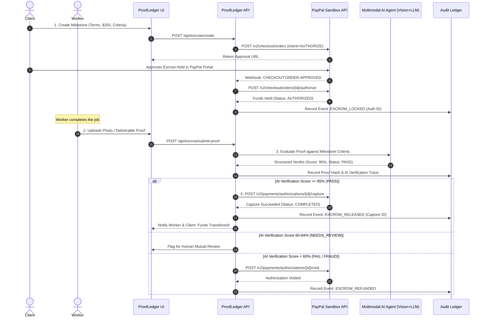

# ProofLedger: Comprehensive Project Blueprint & Execution Guide

**Project Name:** ProofLedger  
**Tagline:** Autonomous AI Escrow & Milestone Verification Powered by PayPal  
**Target Categories:** Grand Prize ($12,000), Best Use of Agentic Commerce ($5,000), Best Use of PayPal + AI ($5,000), Most Impactful ($5,000)

---

## 1. Executive Summary & The Problem

### The Trust Gap in the \$1.5T Gig & Service Economy
Every day, millions of freelancers, field technicians, contractors, and remote knowledge workers face the same double-sided dilemma:
1. **The Client's Fear:** *"If I pay upfront, will the work actually be delivered as agreed, or will I get scammed?"*
2. **The Worker's Fear:** *"If I do the work first, will the client actually pay me, or will they ghost me / demand infinite revisions?"*

Traditional escrow solutions fail this market:
* Bank escrows are slow, expensive, and require extensive legal contracts.
* Upwork/Fiverr take massive **10% to 20% platform cut** on top of transaction fees.
* Standard PayPal peer payments offer no built-in milestone delivery verification.

### The ProofLedger Solution
ProofLedger turns PayPal into an **Autonomous AI-Verified Escrow Network**:
* Clients lock milestone funds using PayPal's native two-step authorization (`intent=AUTHORIZE`).
* Workers submit verifiable proof of completion (photos of physical work, code pull requests, signed receipts, deliverable documents).
* An **Autonomous Multimodal AI Agent (Vision + LLM)** serves as an objective escrow oracle, inspecting the submitted proof directly against the milestone's contractual criteria.
* If criteria are verified, the AI agent autonomously executes a PayPal capture to pay the worker instantly.
* Every transaction, proof hash, and AI reasoning trace is sealed in an auditable **Proof Ledger**.

---

## 2. End-to-End System Architecture



---

## 3. The Multimodal AI Verification Oracle

### Prompt & Verification Engine Design
The AI is instructed to act as a strict, impartial forensic auditor comparing deliverables against predefined specifications.

#### Input Schema to AI:
```json
{
  "milestone_id": "MS-9021",
  "title": "HVAC Capacitor Replacement & Pressure Calibration",
  "specifications": [
    "Original malfunctioning capacitor removed",
    "New brand-name dual run capacitor securely wired",
    "Analog or digital manifold gauge showing stable pressure reading between 60-70 PSI",
    "Work area clean with no exposed cut copper"
  ],
  "proof_image_urls": ["https://proofledger.app/uploads/proof_ms9021.jpg"]
}
```

#### System Instructions for Vision LLM:
```text
You are the ProofLedger Autonomous Verification Oracle.
Your duty is to verify whether submitted photographic/documentary evidence satisfies every contractual criterion.
Be rigorous, objective, and conservative. Look for visual inconsistencies or tampering.

Respond strictly in the following JSON format:
{
  "confidence_score": 0 to 100,
  "verdict": "PASS" | "NEEDS_REVIEW" | "FAIL",
  "criteria_checklist": [
    {
      "criterion": "description",
      "satisfied": true | false,
      "visual_evidence": "Detailed observation from image"
    }
  ],
  "summary_reasoning": "Concise justification for release or hold"
}
```

---

## 4. The Immutable "Proof Ledger" & Dispute Protection

### What Happens If a Client Files a Chargeback Later?
On typical freelance platforms, when a client disputes a payment months later, the contractor is left scrambling for screenshots.
With **ProofLedger**:
1. When proof is submitted, the backend computes a SHA-256 cryptographic hash of the deliverable file.
2. The hash, milestone metadata, AI inspection verdict, and PayPal `authorization_id` / `capture_id` are permanently timestamped.
3. If a dispute event is received from PayPal (`CUSTOMER.DISPUTE.CREATED`), ProofLedger automatically packages a **1-Click PayPal Dispute Evidence Pack**:
   * Original agreed contract & specifications
   * Time-stamped deliverable proofs & image hashes
   * Full AI forensic verification log
   * PayPal authorization and capture receipts

---

## 5. Winning 3-Minute Demo Video Script

Judges evaluate submissions based heavily on the public YouTube demo video (<3 minutes). Follow this script to maximize points:

### 0:00 - 0:30 | The Hook & The Problem
* **Visual:** Speaker on camera / animated title card.
* **Audio:** *"Freelancers and contractors deliver over \$1.5 trillion in global services every year. But everyone dreads the awkward standoff: 'Do you pay me before I work, or do I work before you pay me?' Platform escrows charge up to 20% in fees, while standard peer payments leave both sides unprotected. Meet ProofLedger: the world’s first autonomous AI escrow platform powered by PayPal."*

### 0:30 - 1:15 | Scene 1: Locking the Escrow
* **Visual:** Screen recording of ProofLedger UI.
* **Action:** Client sets up a \$250 milestone for a solar panel inspection. Clicks **"Lock Escrow with PayPal"**.
* **Audio:** *"As the client, I set clear deliverable criteria and click Lock Escrow. Notice that ProofLedger doesn't immediately pull the cash out of my hands—it uses PayPal's native `AUTHORIZE` flow. The \$250 is safely locked in PayPal's rails, guaranteed for the contractor, but not released until verified."*

### 1:15 - 2:05 | Scene 2: Submitting Proof & Live AI Verification
* **Visual:** Switch to Worker view on mobile / desktop.
* **Action:** Worker uploads the completed job photo. The UI shows an animated scanner scanning the deliverable.
* **Audio:** *"The contractor finishes the job and uploads proof. Immediately, the ProofLedger AI Verification Oracle springs into action. Using multimodal computer vision, it checks every contractual requirement in real time: wiring intact, multimeter displaying proper voltage, serial number verified."*
* **Visual:** Checklist lights up green: `Confidence Score: 96% — VERIFIED`.

### 2:05 - 2:35 | Scene 3: Autonomous Capture & The Proof Ledger
* **Visual:** Instant alert appears: *"PayPal Order #PAY-8829 Captured Successfully"*.
* **Audio:** *"Because the proof cleared our 85% threshold, our backend autonomously called PayPal’s capture API. Funds land in the worker’s PayPal wallet instantly, with zero human middlemen. And look at the Proof Ledger tab: every photo hash, AI reasoning trace, and PayPal capture ID is permanently recorded for dispute protection."*

### 2:35 - 3:00 | Conclusion & Impact
* **Visual:** Summary architecture diagram & GitHub repo preview.
* **Audio:** *"ProofLedger combines PayPal's battle-tested payment rails with autonomous agentic intelligence to make trustless global commerce seamless, fair, and instant. Thank you!"*

---

## 6. Devpost Submission Text Template

Use this pre-drafted text for your Devpost project submission page:

### Inspiration
As remote work and independent contracting explode globally, trust remains broken. Freelancers fear doing work without guaranteed payment, while clients fear prepaying unverified contractors. Traditional escrows are cumbersome and charge up to 20% in platform fees. We asked ourselves: *What if an autonomous AI agent could act as a fair, objective escrow oracle on top of PayPal's global rails?* That was the spark for ProofLedger.

### What it Does
ProofLedger is an autonomous milestone escrow platform. A client specifies deliverables and authorizes funds using PayPal (`intent=AUTHORIZE`). When the service provider submits photographic or digital proof of completion, a multimodal AI verification agent analyzes the deliverable against contractual criteria. If verified, ProofLedger autonomously executes a PayPal capture to pay the contractor instantly. An immutable audit log records the evidence to protect against future disputes.

### How We Built It
* **Payment Rails:** Built on PayPal REST API v2 using the two-step `Authorize` and `Capture` endpoints, coupled with PayPal Sandbox Webhook listeners for real-time order tracking.
* **AI Engine:** Multimodal LLM (Gemini / OpenAI Vision) equipped with structured schema generation to perform granular criteria audits.
* **Full Stack:** Modern React + Tailwind CSS dashboard with a robust Node.js/Express backend managing state, cryptographic proof hashing (SHA-256), and ledger persistence.

### Challenges We Ran Into
Handling edge cases in visual quality (e.g. blurry photos or ambiguous deliverables) required crafting rigorous prompt guardrails and a three-tiered verdict system (`PASS`, `NEEDS_REVIEW`, `FAIL`) rather than a naive binary release. Additionally, ensuring idempotency across PayPal's authorization and capture cycles ensured no double-spending could occur.

### Accomplishments That We're Proud Of
Creating an end-to-end, zero-human-touch commerce loop where an AI agent inspects real-world work deliverables and directly authorizes financial settlement over real PayPal payment rails.

### What's Next for ProofLedger
1. Expanding beyond physical photos to automated GitHub pull request audits for software bounties.
2. Direct integration into messaging platforms (Slack & WhatsApp) for seamless local trade escrow.
3. Multi-currency settlements using PayPal Payouts for cross-border contractor teams.
