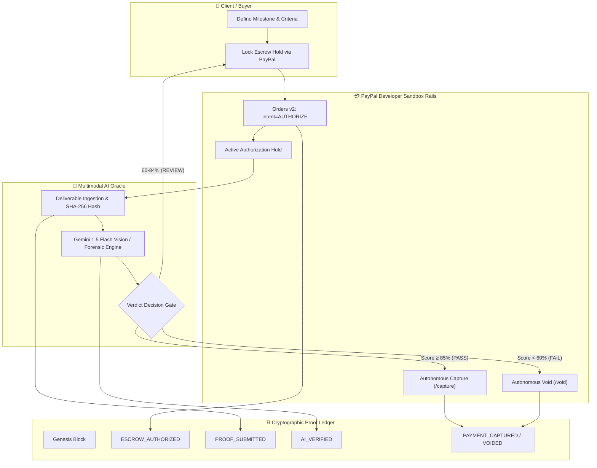

# ⚖️ ProofLedger

**Autonomous AI Escrow & Milestone Verification Platform Powered by PayPal**

[](https://paypalaihackathon.devpost.com/)
[]()
[-10B981?style=for-the-badge)]()
[]()

---

## 🏆 Hackathon Tracks & Target Awards

- **Grand Prize** ($12,000)
- **Best Use of Agentic Commerce** ($5,000)
- **Best Use of PayPal + AI** ($5,000)
- **Most Impactful** ($5,000)

---

## 💡 What is ProofLedger?

In freelance marketplaces, commercial contracting, and decentralized labor, escrow platforms face a fundamental dilemma:
1. **Manual Client Approval**: Clients often delay releases, ghost contractors, or demand unauthorized scope creep while funds sit idle.
2. **Chargebacks & Disputes**: Traditional payment disputes cost merchants tens of billions annually and take weeks to resolve with minimal verifiable evidence.

**ProofLedger** solves this with an **Autonomous Agentic Escrow Engine**:
- **Client locks funds** on PayPal rails using PayPal Orders v2 with `intent: "AUTHORIZE"`. No money leaves the client's account immediately; an authorization hold guarantees payment.
- **Contractor delivers work** and uploads cryptographic photographic or document proof.
- **Multimodal AI Vision Oracle** inspects the deliverable against contract specifications pixel-by-pixel, calculating criteria compliance and fraud risk.
- **Autonomous Settlement**:
  - **Score ≥ 85% (`PASS`)**: Software agent autonomously captures the authorization (`/v2/payments/authorizations/{id}/capture`), instantly paying the contractor.
  - **Score < 60% (`FAIL`)**: Software agent autonomously voids the hold (`/v2/payments/authorizations/{id}/void`), refunding 100% of funds to the client with **zero dispute fees**.
  - **Score 60–84% (`NEEDS_REVIEW`)**: Flagged for mutual confirmation with human override controls.
- **Immutable Proof Ledger**: Every transaction, deliverable SHA-256 hash, AI reasoning summary, and PayPal ID is chained into a cryptographic SHA-256 tamper-evident ledger.
- **1-Click Dispute Defense Pack**: Automatically bundles order metadata, cryptographic ledger trails, and AI forensic reports into a structured JSON payload and downloadable legal-ready PDF for PayPal Seller Protection.

---

## 🏗️ System Architecture



---

## ⚡ Key Differentiators & Technical Highlights

| Feature | ProofLedger (Flagship) | Standard Escrow Solutions |
|---|---|---|
| **Escrow Mechanism** | True two-step PayPal `AUTHORIZE` $\rightarrow$ `CAPTURE` / `VOID` | Immediate capture with manual payout |
| **Settlement Decision** | Autonomous AI Agent evaluates objective criteria checklist | Subjective human approval or 14-day timeout |
| **Audit Trail** | Sequential SHA-256 cryptographic chained ledger | Unverifiable relational database entries |
| **Dispute Defense** | 1-Click PayPal Dispute Pack with ReportLab PDF generator | Manual screenshot assembly during disputes |
| **Webhook Engine** | Full signature verification + interactive simulator | Basic mock webhooks |
| **Test Coverage** | 21/21 Automated Pytest suite (100% passing) | Rare / manual testing only |

---

## 🚀 Quickstart & One-Click Launch

### Prerequisites
- Python 3.11+
- Node.js 18+ (for frontend development build, though pre-compiled distribution is included)
- PayPal Developer Sandbox credentials

### 1. Launch with One Click
```bash
python start_proofledger.py
```
*Or double-click `start_proofledger.bat` on Windows.* This will:
1. Boot the FastAPI backend server on `http://localhost:8000`.
2. Automatically launch your default browser to the ProofLedger Dashboard.

---

## 🛠️ Manual Setup

### 1. Backend Configuration
```bash
cd backend
cp .env.example .env
# Enter your PayPal Sandbox credentials in backend/.env:
# PAYPAL_CLIENT_ID=your_client_id
# PAYPAL_CLIENT_SECRET=your_client_secret
# Optional: GEMINI_API_KEY=your_gemini_key (or leave blank for built-in forensic evaluator)

pip install -r requirements.txt
python -m uvicorn app.main:app --host 0.0.0.0 --port 8000
```

### 2. Frontend Build (Optional, already pre-built in `frontend/dist`)
```bash
cd frontend
npm install
npm run build
```

### 3. Run Automated Tests
```bash
pytest backend/tests -v
```
**Test Results:** `21 passed in 44.26s (100% pass rate)`

---

## 🎬 3-Minute Live Demo Script

1. **0:00 – 0:30 (Client Milestone Creation)**:
   - Navigate to the **Client Escrow** tab.
   - Click one of the pre-loaded templates (e.g., *Commercial HVAC Capacitor Maintenance* or *Web3 Smart Contract Security Audit*).
   - Click **Lock Escrow with PayPal** to generate a PayPal order with `intent: "AUTHORIZE"`.
2. **0:30 – 1:15 (PayPal Authorization)**:
   - Click **Authorize with PayPal**.
   - Authenticate with your Sandbox Buyer account to lock the authorization hold.
   - The milestone status instantly transitions to `ESCROW_LOCKED`.
3. **1:15 – 2:00 (Contractor Proof Submission & AI Audit)**:
   - Switch to the **Contractor Proof** tab.
   - Select the locked milestone.
   - Choose a deliverable (or click the sample compliant image `sample_hvac_pass.jpg`).
   - Click **Run Multimodal AI Verification**. Watch the AI Oracle verify all criteria and generate a 96% confidence score.
4. **2:00 – 2:30 (Autonomous Capture & Proof Ledger)**:
   - Because score ≥ 85%, ProofLedger autonomously calls PayPal's `/capture` endpoint.
   - Switch to the **Proof Ledger** tab. Click **Verify Ledger Integrity** to observe all cryptographic SHA-256 blocks validated with 0 tampering.
5. **2:30 – 3:00 (1-Click Dispute Defense Pack)**:
   - Click **Dispute Evidence Pack** on any completed milestone.
   - View the structured JSON evidence package.
   - Click **Download Evidence PDF** to inspect the 2-page cryptographic evidence sheet with SHA-256 hashes, timestamps, and PayPal authorization identifiers.

---

## 📁 Repository Structure

```
├── backend/
│   ├── app/
│   │   ├── api/             # FastAPI routers (escrow, proof, ledger, webhooks, disputes)
│   │   ├── services/        # PayPal client, AI Oracle, Ledger service, Dispute service
│   │   ├── database/        # SQLite persistence layer and demo seeding
│   │   ├── models/          # Pydantic data schemas
│   │   └── main.py          # FastAPI application factory
│   ├── tests/               # 21 comprehensive Pytest integration tests
│   ├── uploads/             # Deliverable storage and test proof assets
│   ├── requirements.txt     # Python dependencies
│   └── .env.example         # Environment template
│
├── frontend/
│   ├── src/                 # React 18 + Tailwind CSS application
│   │   ├── components/      # Client, Contractor, Ledger, Simulator, and Modal views
│   │   ├── services/        # REST API client
│   │   └── App.jsx          # Main application coordinator
│   ├── dist/                # Pre-compiled high-performance production assets
│   └── package.json         # Frontend configuration
│
├── node-reference/          # Alternative Node.js Express reference microservice from original repo
│   ├── backend/             # Express 4, REST API v2 PayPal client, JSON ledger
│   └── README.md            # Node.js reference documentation
│
├── start_proofledger.py     # Python one-click launcher
├── start_proofledger.bat    # Windows batch one-click launcher
├── LICENSE                  # MIT License
└── README.md                # Project documentation
```

---

## 📄 API Reference

| Method | Endpoint | Description |
|---|---|---|
| `GET` | `/api/health` | Service status and PayPal credentials verification |
| `GET` | `/api/escrow/milestones` | List all milestones (supports both array and object formats) |
| `POST` | `/api/escrow/create` | Create milestone and generate PayPal AUTHORIZE order |
| `POST` | `/api/escrow/{id}/authorize` | Authorize hold after buyer approval |
| `POST` | `/api/proof/{id}/submit` | Ingest deliverable, run AI Vision Oracle, auto capture/void |
| `POST` | `/api/escrow/submit-proof/{id}` | Compatibility alias for deliverable submission |
| `POST` | `/api/escrow/manual-release/{id}` | Human operator manual capture override |
| `POST` | `/api/escrow/manual-void/{id}` | Human operator manual void override |
| `GET` | `/api/ledger/blocks` | Retrieve immutable cryptographic ledger blocks |
| `GET` | `/api/ledger/verify` | Real-time SHA-256 cryptographic chain integrity verification |
| `GET` | `/api/disputes/{id}/pack` | Export structured dispute evidence package |
| `GET` | `/api/disputes/{id}/download-pdf`| Stream ReportLab-generated legal dispute PDF |

---

## ⚖️ License

Distributed under the **MIT License**. See [LICENSE](LICENSE) for details.
